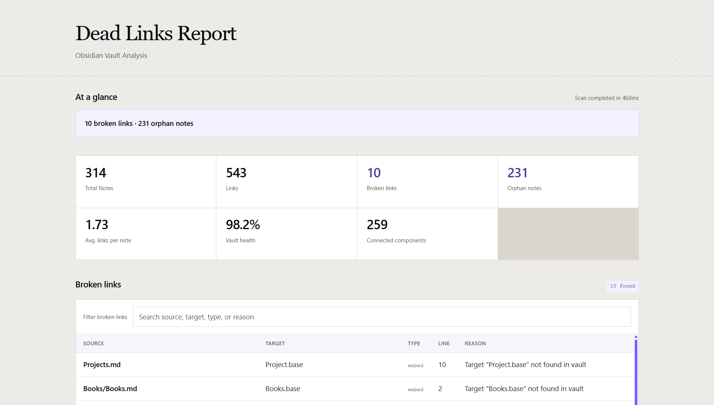

# dead-links

Scan an Obsidian vault for broken links, orphan notes, and note connections. Run commands from the vault directory for the shortest workflow, or pass `--vault` when working elsewhere.

## Quick start

From the vault directory:

```bash
npx dead-links scan
npx dead-links report --output dead-links-report.md
```

From another directory:

```bash
npx dead-links scan --vault "D:/Notes/MyVault"
npx dead-links report --vault "D:/Notes/MyVault" --output report.md
```

`scan` prints results in the terminal by default. `report` saves a Markdown report. Both use the current directory as the vault unless `--vault` is provided.

## Commands

### `scan`

Analyze the vault and print or export the results.

```bash
dead-links scan [options]
```

| Option | Description |
|--------|-------------|
| `--vault <path>` | Vault directory (default: current directory) |
| `--format <type>` | Output format: `text`, `json`, `markdown`, `csv`, or `html` (default: `text`) |
| `--output <file>` | Write results to a file instead of the terminal |
| `--ignore <patterns...>` | Glob patterns to skip |
| `--attachments` | Check embedded attachments such as images and PDFs |
| `--ignore-folders <folders...>` | Exclude folders from orphan-note results |
| `--quiet` | In text format, print only findings |
| `--no-color` | Disable colors in text output |
| `--debug` | Print additional scan details |

Examples:

```bash
# Interactive HTML report
npx dead-links scan --format html --output report.html

# JSON output
npx dead-links scan --format json --output report.json

# Skip template and trash folders
npx dead-links scan --ignore "**/Templates/**" "**/.trash/**"
```

### `report`

Generate a Markdown report containing statistics, broken links, orphan notes, and connection summaries.

```bash
dead-links report [options]
```

| Option | Description |
|--------|-------------|
| `--vault <path>` | Vault directory (default: current directory) |
| `--output <file>` | Report path (default: `dead-links-report.md`) |
| `--ignore <patterns...>` | Glob patterns to skip |

## Output formats

- **Text** — scan statistics, broken links, and orphan notes in the terminal.
- **JSON** — machine-readable scan results, including note connections.
- **Markdown** — readable report with statistics, issues, orphan notes, and the most-connected notes.
- **CSV** — tabular issue data for spreadsheets.
- **HTML** — a responsive report with overview metrics, searchable issue tables, and note connections.

Files are written relative to the current directory unless an output path is specified. Open `report.html` in a browser to view an HTML report.



## Configuration

For persistent scan settings, create `.deadlinksrc.json` in the vault root:

```json
{
  "ignore": ["**/Templates/**", "**/.trash/**"],
  "ignoreFolders": ["Films", "Diary", "Books"],
  "checkAttachments": false,
  "debug": false
}
```

Command-line options override the corresponding configuration values.

## Links detected

- `[[Note]]` — Obsidian wiki links
- `[[Note|Alias]]` — wiki links with aliases
- `[[Note#Section]]` — links to headings
- `[[Note#^blockid]]` — links to blocks
- `![[image.png]]` — embedded attachments
- `[text](file.md)` — Markdown links

## License

[MIT](LICENSE)
